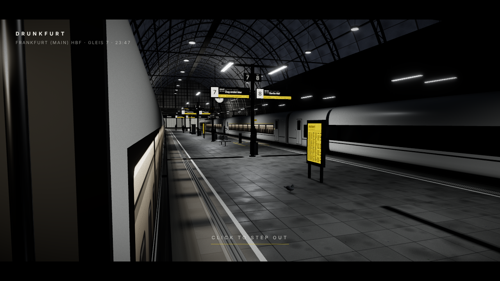

# DRUNKFURT

A scroll-driven, first-person 3D comic set in Frankfurt am Main at night.
DRUNKFURT is the name of the experience and its fictional world; Frankfurt am Main is the real
setting, so real places and railway signage keep their real names.
Four episodes are built:

- **Episode 01, Arrival**: Frankfurt (Main) Hbf, platform 7, a few minutes before midnight.
- **Episode 02, City**: out of the station, down the boulevard towards the towers, and a stranger who wants your bag.
- **Episode 03, Getaway**: past the man on the pavement to a Mercedes at the kerb, into the driver's seat, and away (hold D to rev).
- **Episode 04, Home**: a back room full of surveillance screens; sit down at the big one and click it to go through to the real site, arianatmar.com.



## Run

Requires Node 18+ (developed on Node 22).

```bash
npm install
npm run dev        # http://localhost:5173
npm run build      # typecheck + production build into dist/
npm run preview    # serve the production build
npm run typecheck
```

**Scroll** to move through the story (wheel, trackpad, touch, keyboard). **Click** or **Enter**
jumps to the next composed beat. Moving the mouse lets you look around a few degrees; the
camera always returns to the composed frame.

## Interaction model

There is no walking. The camera is on rails: each episode owns a span of the page's scroll
and a camera track (keyframes with position, yaw, pitch, roll and field of view, sampled with
Catmull-Rom). Scroll position → global progress → episode + local progress → camera pose.
Progress is damped so scrolling feels like moving a dolly. Footstep bob appears only while
the camera is travelling. Scroll also drives events: in Episode 1 a traveller crosses in
front of you and the train door slides shut behind you, both scrubbing backwards when you
scroll up. Ambient life (pigeon, dust, tickers, the clock, one flickering tube) runs on time.

## People in the station

**Figures** (`src/characters/`) are illustrated people, not capsule mannequins:

- `shapes.ts` lofts the body through cross-sections taken where anatomy changes:
  - the torso runs from the waist and ribcage through the chest and armpits, then the
    shoulders slope through the trapezius into the neck;
  - the deltoids are domes over the shoulder joints, below the trapezius line;
  - limbs swell at the thigh, the calf and the forearm, and trousers fall straight;
  - the head (`anatomy.ts`) runs from the chin through the jaw, cheekbones and brow to the
    crown, with the back of the skull behind the face;
  - hands have a palm, a thumb and four fingers of three phalanges each. An open hand and a
    fist come from the same generator, with different finger curl;
  - shoes have a heel counter, an instep rising to an ankle collar, laces, a rounded toe box,
    a sole slightly wider than the upper and a little toe spring.
- Outfits change the silhouette: coat, parka, jacket, hoodie, dress. Props include a
  backpack, shoulder bag, tote, rolling suitcase and phone. Builds vary from slim to broad
  and soft, and heights from 1.62 m to 1.86 m.
- `figure.ts` builds a skeleton (hips → spine → head and shoulders → elbows → wrists, plus
  hips → knees → ankles). Each person is one skinned mesh with vertex colours:
  - each part is weighted to its bone, blending into the neighbouring bone around every
    joint, so elbows, knees, hips and shoulders bend instead of opening a gap;
  - coat skirts and hems hang from the hips and follow the legs part of the way;
  - hands are separate meshes on the wrists (open or a fist).
- `pose.ts` poses figures by activity:
  - waiting, hands in pockets, a phone in hand, a phone at the ear;
  - talking and listening (arms folded, nodding), looking up at the board;
  - smoking, adjusting a backpack, sitting, resting a hand on a suitcase.
- Standing figures shift their weight between legs, breathe, and glance around. Gestures
  come from a deterministic event scheduler, so two people never move in sync.
- The walk is motion capture (`walkClip.ts`), from the supplied "Mr Man Walking" model
  (a Mixamo-rigged character with a 1.03 s walk cycle):
  - `tools/bakewalk.mjs` bakes the clip into `walkCycle.json` (40 KB instead of the 18 MB FBX).
    It stores pelvis, chest, head and feet as rotations away from standing, every limb segment
    as a direction in character space, the hip sway, and which foot carries weight.
  - Any of our skeletons is posed by turning each joint so its own segment points the captured
    way, so it works on the drawn people and on the stranger's fitted rig alike, whatever
    their proportions. Only the motion is used; the model itself is not in the scenes.
  - The clip walks in place at 1.64 m/s, 1.70 m per cycle. Slower walkers take
    proportionally shorter steps (down to 55%) rather than the same long steps at a slower
    beat, and the cycle advances by distance walked with the matching stride.
  - The walk blends in over whatever stance a person has when they set off, and out again
    when they stop; it starts with the weight on the foot under the hips.
- Feet are pinned while they carry weight (`feet.ts`):
  - a foot that touches down stays on that spot, and the leg is solved to reach it with
    two-bone IK, knee forwards;
  - the foot keeps its heading while the body turns above it, so turning on the spot is a
    few steps rather than feet rotating on the floor;
  - the pelvis drops just enough for a pinned foot to stay down, and a free foot is never
    pushed through the floor;
  - at lift-off the foot is released and blends back into the swing.

  This holds through starting, stopping, slowing and turning. In a 40 s test (walk, slow,
  stop, turn round, set off again; 2,748 frames with a foot down), planted feet do not
  move at all, against 7.5 m of slip for the captured walk alone. The feet never float,
  and they sink at most 1.2 cm into the floor.
- People draw only silhouette ink lines (contour and overlaps), so figures read as clean
  shapes.

**The cast** (`src/scenes/station/crowd.ts`) is mostly stationary:

- two colleagues talking, someone looking up at the destination display, a smoker, someone
  on a call, someone on their phone;
- two people on a bench, a traveller adjusting a backpack, someone waiting with a suitcase;
- two people under the concourse board;
- only a few walk: the traveller who crosses in front of you (driven by scroll), one person
  with a rolling suitcase, a commuter, and two people in the concourse.

**Paths and obstacles**: `nav.ts` builds the walkable areas (the platform behind the white
lines, the concourse) and obstacle footprints from the same placement data the furniture is
built from.

- Every spot and route is validated against the obstacle map, with a console warning in dev
  builds.
- Walkers keep to their own strip of floor and slow down or wait for anyone in their way.
  After a while they step aside to a free spot.
- The scroll-driven traveller's position and gait phase are pure functions of scroll
  position, so scrubbing back replays them exactly.

## Rendering: an illustrated world with real depth

- **Tonal bands** (`src/render/comic.ts`): every lit material keeps three's lighting and
  shadows. Its final colour is quantised into five printed tones: ink, charcoal, mid, light
  and paper. Band edges resolve as narrow screen-space halftone transitions, so dots sit where
  light turns into shadow rather than across whole surfaces. Hue is kept, so yellow stays
  yellow in every band. Each material chooses how it prints (`PRINT` in
  `src/materials/materials.ts`, or `material.userData.comic`):
  - clean band edges (`halftone: 0`) for the roof glazing, window glass, trim, yellow paint
    and safety lines;
  - narrower dots (`halftone` < 1) for the train bodies, trusses and passengers;
  - hatching (`hatch: true`) only on masonry, the platform walls and undercarriage;
  - `false` for signage, so it stays legible.
- **Selective ink** (`src/render/ink.ts`, `Stylizer.tsx`): every opaque mesh is drawn once
  into a normal/depth buffer, either as *ink* geometry or as a line-free *occluder*. Lines come
  only from ink geometry. Silhouettes are heavy, creases are lighter, and both thin and fade
  with distance. Glows, displays, light spill, dust and sky never get outlines. Objects opt out
  with `userData.ink = false`.
- **Hand-drawn quality**: band edges wander with low-frequency world-space noise, like a brush.
  Lighter transitions have a soft charcoal grain, and shadow transitions use coarse halftone
  dots with slight jitter. Ink lines change width like pen pressure, redraw their wobble four
  times a second, and break now and then like dry ink.
- **Paper**: fibre and tooth over the whole frame, with highlights tinted towards paper.
- **Grade**: no filmic tone mapping, so paper white stays white. A little bloom on light
  sources only, and a vignette.
- **Simplified world**: roof ribs are two clean chords (no lattice), with fewer purlins and no
  catenary droppers. The floor has large slabs with soft joints. Textures print as flat fills.
- **Captions** are cut-paper strips held down with yellow tape.

## Episode 02: City

`src/scenes/city/`. The episode's beats, by local scroll progress, are listed in `track.ts`:

| Beat | Local progress |
| --- | --- |
| Under the station portal, behind the ink wipe and the EPISODE 02 / CITY title | 0–0.10 |
| Out onto the square: the boulevard, the houses and the skyline | 0.10–0.22 |
| A look around: the kiosk, the tram stop | 0.22–0.40 |
| Across the zebra crossing and down the right sidewalk | 0.40–0.60 |
| He notices you, leaves a doorway ahead and walks at you, eyes on you | 0.56–0.735 |
| He stops square in front of you; his face hardens; he shifts his weight | 0.735–0.80 |
| He draws a knife and holds it on you: "Your bag. Give it to me. Now." | 0.74–0.83 |
| He commits: the city drops to a tenth of real speed | 0.822 |
| DEFEND, CLICK TO DEFEND: he stands and threatens in slow motion; the story waits here | 0.83 |
| Black; BAM! WHAM!; the page opens on him lying on the pavement | real time, ~2 s |

- **The world**:
  - the station's head building with its arched portal;
  - a square with a kiosk, a tram stop (with a DRUNKFURT poster) and tram tracks, and a zebra
    crossing;
  - a long boulevard of 19th-century blocks. Their facades are line drawings (procedural canvas
    textures with wobbly ink) and they have shopfronts, mansard roofs and chimneys;
  - bare trees, curved street lamps, blinking amber traffic lights, parked cars, and three moving
    cars with headlight beams and reflections in the wet road;
  - the skyline as silhouettes: a triangular tower with a lit crown, a cylinder with an antenna,
    the twin towers, a feather crown and an inverted pyramid. These shapes evoke Frankfurt's
    banking district and are not surveyed.
- **Wet asphalt is selective**: low roughness only in puddles and patches (a roughness map),
  plus soft light streaks under lamps and headlights.
- **People**: the same character system as Episode 1, with its own cast and nav (`cast.ts`,
  `nav.ts`):
  - two friends at the kiosk, someone on their phone at the tram stop, a traveller just off the
    train, someone looking up at the towers;
  - a smoker outside a bar, someone on a call, two people talking further down;
  - two walkers, each on their own validated strip of sidewalk.
- **The stranger** (`Stranger.tsx`, body in `characters/manRig.ts`) is the supplied walking
  man ("Mr Man Walking", a Mixamo-rigged character with his own captured walk), dressed down as a
  man who sleeps rough:
  - his clothes are re-made from the fabric of the first attacker scan (`tools/dress_textures.py`):
    a filthy tan canvas jacket, washed-out torn jeans with a ripped knee and frayed hems,
    scuffed shoes, weathered skin, his beard and moustache kept as hair cards;
  - a knit beanie and a scarf are added at load, fitted to his head and neck from his skin's own
    vertices;
  - he walks with his own captured walk (straight legs, an upright gait), its cycle locked to the
    distance he covers on his route: 1.67 m per cycle at his 1.8 m. Measured in a node test, a
    planted foot slides 4.6 mm at most per centimetre walked, and no toe goes below the
    pavement;
  - his stance at the stop is taken from his walk where both feet are down, with the legs eased
    towards standing straight;
  - his head and neck turn to you from the moment he notices you; a key light from the shop
    windows lights his face.
  - He is printed in greys (`mono` in `render/comic.ts`) like everyone in the city, with a
    selective ink silhouette (none on the hair cards).
- **The knife** (`src/assets/knife.glb`, supplied) sits in his right hand, the fingers closed round
  the handle. He draws it as he squares up, then holds it out at chest height, forearm level,
  the blade up and leaning towards you so it reads along its length: two-bone IK on his arm
  places the hand and the wrist turns the blade with about 20° of bend, a hold a real wrist
  takes without strain. As he raises it your eyes drop to it (the camera pitches down and
  widens), and the DEFEND card sits off-centre so his face and the knife stay in view. He does not strike; a speech balloon (`tone: 'speech'` captions) carries what he
  says: "Your bag. Give it to me. Now."
- **His walk** is sampled straight from the clip's keyframe tracks every frame, not through an
  `AnimationMixer`: the mixer only writes a bone whose value changed since its last write, and
  since his pose is rebuilt from rest every frame, a still scroll left him in his T-shaped bind
  pose. The walk is blended into his stance by pace, so his legs swing at every speed and slow
  into the stop.
- **The encounter** (`encounter.ts`) is drawn as a function of the scroll progress. The
  only thing it remembers is the visitor's decision at the gate. `encounterAt(local)` gives the
  stranger, the camera, the overlay and the soundscape everything they draw
  from. Intervals (local progress, `beats.ts`):

  | Interval | What happens |
  | --- | --- |
  | 0.60–0.735 | he walks up |
  | 0.735–0.80 | he squares up and holds your eye; the knife comes out |
  | 0.80–0.822 | he raises it and holds it on you; he tells you to hand over your bag |
  | 0.822–0.83 | time slows to a tenth |
  | 0.83 | DEFEND: the story waits for your click ("Click to defend") |
  | 0.83–0.905 | the outcome, spread over this stretch of the scroll |
  | 0.905–1 | the aftermath |

  - **Defended** (you click in time): the fight is not shown. The page goes black at once,
    before anyone moves, and the two hits are printed into the dark as comic sound effects
    (`drawHits` in `ui/brush.ts`): BAM! and WHAM! burst in on jagged paper stars, each with its
    sound. When the ink opens again he is on his back on the pavement, the knife beside his
    hand, and your bag is still with you.
  - **Knocked out** is switched off for now (`STRIKES` in `encounter.ts`): he never strikes, and
    the story waits at the gate until you defend. Its sequence is kept: with `STRIKES` on, the
    blade reaches you 3.7 s after the prompt, a blow lands, the eyelids close in ragged ink, the
    camera falls to the pavement, and when you come to he is gone and the bag lies next to you.
  - Once you decide, the page plays the outcome by moving the progress itself (`playProgress` in
    `core/timeline.ts`, wall-clock timed). Scrolling yourself takes over at once. Every frame of
    the fight is a position on the scroll, so scrolling back rewinds it: into the middle of the
    fight you see that moment, and before he walks up he is back in his doorway. Scrolling
    forward again replays the same outcome. The prompt does not come back once you have decided.
  - The DEFEND prompt waits as long as you like. Scroll back before the gate and it closes;
    the moment is postponed, not decided.
  - Sounds are cues fired as the playback crosses them, forwards only. They never feed back
    into what is drawn, and scrubbing never repeats them.
- **Time**: everything in the city (people, cars, the stranger) runs on a time scale that eases
  to 10% as he closes in.
- **Traffic** (`traffic.ts`, plan in `trafficPlan.ts`) is a few scripted cars on fixed lanes,
  deterministic and pure (fixed sub-steps, no randomness):
  - Each car is an oriented box over its body and tyres. Lanes are polylines with arcs at the
    corners, sampled by arc length, so heading never jumps.
  - The driving lanes run at ±1.75 m from the middle of the boulevard, clear of the parked cars
    (0.36 m to spare). Before this, a lane ran at 2.3 m and the passing car's tyres cut
    through the parked cars.
  - Each step a car sweeps its box along its lane as far as it needs to stop, plus a following
    gap. It slows to stop 1.6 m short of the first parked car, visitor or car it would touch.
  - Where lanes cross or merge, the car that would arrive later yields; ties go to the
    priority lane. A move that would make two boxes overlap is never made, and spawning
    waits until the entry is clear.
  - A third car comes up the boulevard and turns into the cross street, crossing one car's lane
    and merging into another's, so the junction gets real give-way traffic.
- **Fight sounds** are distinct sounds, each timed to its contact:
  - in the dark of a defence, an exhale and a dull, bony knock with BAM!, then a heavier exhale
    and a hard crack with a deep thump with WHAM!;
  - on a knockout: his exhale, a heavy hit, a ringing ear and the body hitting the ground.

  Each is synthesised unless a recording is supplied: add files to `public/audio/` and set
  `src` on the `fight*` cues in `src/audio/AudioDirector.ts`.
- **Looking around** with the mouse also moves your head a few centimetres, sideways and up or
  down, so nearby objects shift against the background. The head stays inside a small invisible
  ellipsoid, and each episode can clamp it further (`clampHead`), so the camera never clips into
  walls, people or the attacker.
- **Sound**: the audio graph starts on the first click or key press.
  - There are no recorded assets, so the city uses synthesized sounds: a distant traffic bed,
    tyre noise from passing cars (panned), two impacts and a slow heartbeat at the climax.
  - The ambience thins and muffles (a low-pass sweep) as the stranger approaches.
  - A "Sound on/off" switch sits top right.
- **Transitions**: brush-stroke wipes are drawn on a canvas (`ui/brush.ts`). They are ragged
  black strokes with bristle tips, not a fade, and they close an episode, carry its title and
  open the next one.
  - The hand-over between episodes plays by itself (`pageTurns` in `core/timeline.ts`): once
    the progress enters it, it is carried to the far side in the direction you were scrolling
    (on to the next episode's first shot, or back to the last shot of the one before) in about
    3 s, and scrolling cannot stop it halfway. You never have to scroll a wipe open or shut.

## Episode 03: Getaway

`src/scenes/car/`. It starts exactly where Episode 02's last shot is (you, crouched by the man
on the pavement) and plays on the same street: the episode declares `sharesWorld: 'city'` and
its span is `seamless`, so there is no page turn between them and the city keeps drawing and
running behind it. The thief tried for your bag and failed: it never leaves your shoulder, and
nothing of yours is left on the pavement. He stays where he fell, behind you.

| Beat (local progress, `getaway.ts`) | What happens |
| --- | --- |
| 0–0.06 | the last shot of Episode 02 holds; the EPISODE 03 / GETAWAY title comes up over it |
| 0.06–0.13 | you get up and look on down the street: the Mercedes stands at the kerb ahead |
| 0.13–0.40 | about ten steps: past him (more than a metre from him and his knife), off the kerb and along the car to the driver's door on the road side |
| 0.27–0.31 | as you reach it, its lights come up and the central locking clacks |
| 0.40–0.47 | the driver's door opens |
| 0.47–0.60 | into the car: you duck under the roof line, through the door opening, and sit, turning to face the windscreen |
| 0.60–0.66 | the door shuts; 0.645 the cluster lights and the engine starts; your eyes drop to the cluster |
| 0.66 | the story waits: hold D to rev |
| after 6,000 rpm | by itself, without stopping: the launch through three gear changes (8.6 s, the rush in its last two seconds), the ink closing, the next page |

- **The car** is the supplied Mercedes-Benz W206 C220 (`src/assets/mercedes.glb`, 2.2 MB),
  converted from the supplied FBX by `tools/mercedes2glb.mjs`, then welded, simplified and
  quantised with glTF Transform. The conversion keeps the body, the four doors, wheels and
  tyres, lights, glass and the complete cabin (seats, dash, steering wheel, instrument cluster).
  It drops what is never seen (engine, suspension, underbody), the duplicate variants
  (panoramic roof, AMG skirts, a second headlight set), the inner faces of the glass and every
  texture. `scenes/car/carRig.ts` prints it in the city's tones by material name (black paint,
  steel, tinted glass, dark leather) with ink lines on the body.
- **Where it stands**: in the parking lane on the right at z = -41.5, its tail about 3 m beyond
  where the man falls, so you only reach it after the fight. (A plain parked car that stood
  there moved down the street to leave it room to pull out.)
- **What the model has, and how it is driven** (inspected in the FBX, not assumed): its one
  animation is a single static frame of the four door rotations, so nothing in it moves. Each
  door is its own node placed at its hinge, with its panel, glass and mirror as children; the
  driver's door (front left, `w206_door_FL`) opens by turning that node 62° about the vertical
  through the hinge. Each wheel and tyre is its own node at its hub and rolls about the axle by
  distance / 0.325 m. The headlights' lamp materials glow and two spot lights throw the beams.
- **The instrument cluster** (`carCluster.ts`) is the supplied dial illustration ("car
  dashboard UI illustration" by Vecteezy, free licence, credited in the room at the end), adapted
  by `tools/cluster_svg.py` into `src/assets/cluster.svg` and printed on the car's own cluster
  screen: the model's `w206_gauges` panel, 30.8 × 10.4 cm behind the steering wheel, tilted
  15° towards the driver. The graphic sits on a plane 3 mm in front of it, so it is seen in
  perspective through the wheel, lit like a screen, and moves with the car.
  - The original has three dials. The left one is a tachometer (0–10 × 1,000 rpm, red from
    6): it stays a tachometer, and its red zone starts where the launch happens. The right one
    (0–100, fuel) is kept. The middle one is a speedometer labelled 0–160 (mph), with uneven
    labels (140 and 160 squeezed into the bottom) and a grey panel in its centre ("12.24v", a
    battery icon, two lines and a small triangle): the panel and those parts are removed, and
    the speedometer's ticks, labels and ring are rebuilt as 0–300 km/h (ticks every 10, major
    ticks and labels every 50, a 270° sweep), not relabelled. The decorative cowl arc is
    dropped (the car has a real one).
  - Colours go from cyan to an AMG-like cluster: near-black face, white and grey markings, red
    accents (the tachometer's red zone, the needles).
  - The needles are drawn live: the tachometer from the engine's rpm, the speedometer from the
    car's road speed. Revving on the spot moves only the tachometer; the speedometer stays at 0
    until the car moves, and reaches about 180 km/h in the rush. Under the speedometer's hub the gear shows: P parked, D1–D4
    on the launch, flashing red at each change.
  - The model's own tiny tachometer needle is hidden in favour of the new dials.
- **The walk and the entry** are camera keys on the scroll (`episode.ts`), worked out from the
  car's own frame: they keep clear of the man, stand clear of the door's swing, and pass under
  the door opening's top below the roof line. All of it, door and lights included, is a
  function of the scroll, so scrolling back plays it backwards.
- **The rev** (`getaway.ts`): once you sit and the engine idles at 800 rpm, the page holds at a
  gate, your eyes drop to the cluster (the camera tilts down and narrows its view so the dials
  read through the wheel), and a small card says what to do: hold D. The revs climb about
  1,500 + 0.35 × rpm per second (two seconds to the line on the wall clock, the same at any
  frame rate); let go and they fall back to idle smoothly. One listener pair (keydown, keyup)
  is set while the episode is active and removed when it leaves; the key is released when the
  window loses focus or the page is hidden; D does nothing else. On a touch screen, press and
  hold the card.
- **The launch** (at 6,000 rpm, once): `launch()` clears `armed` (so it cannot fire again and D
  is ignored from then on), opens the gate, and starts one scripted move of the page, locked,
  from the gate through the page turn to the next page. Everything after the threshold is that
  one timeline: the car pulls out about its rear axle along an S into the driving lane and
  accelerates (about 11 m/s² off the line, easing through the gears, with the gear changes on
  the recording's), then the rush: the speed builds towards 180 km/h, comic speed lines stream
  in from the edges and the view widens; then the ink closes and the next page (Episode 04, the room) opens. The car's place is only ever set from that progress, by one component.
  Checked in a node test along the whole route: it clears the kerb by at least 10 cm and the
  parked cars by 36 cm. The car that would turn into its lane is kept off the street.
- **Why it used to stall**, fixed: (1) the launch's scripted move ended exactly on the first
  frame of the page turn, and a page turn only starts when the progress is inside it, so after
  3.6 s the car stopped and nothing more happened; (2) the scripted move could be cancelled by
  any wheel or touch event, and people keep scrolling (or a trackpad keeps coasting) while the
  story waits at a gate; (3) even when it was not cancelled, the wheel still scrolled the page
  underneath it, so when it ended the story slid back to where the page had been scrolled.
  Now one locked move runs from the gate to the next page; while a locked move plays (this one,
  or a page turn), and for 1 s after it, wheel, touch and scroll keys are swallowed and the
  page is held on its final position, so a trackpad's inertia cannot carry the story back.
- **State, and rewinding**: everything you see is a function of the scroll, except the revs
  while you hold the key. `getaway.launched` is the one remembered fact. Scroll back into the
  launch and the car is where it was at that point; scroll back out of the seat (before
  0.63) and the launch is forgotten: the gate closes, the engine stops and you rev again next
  time. Nothing before the rev reads `launched`, so no earlier position can show a launched car.
- **Sound**: the supplied recordings (`src/assets/audio/`, used as they are):
  - `accel-1.mp3` (3.1 s), `accel-2.mp3` (6.3 s), `accel-3.mp3` (4.1 s): single throttle blips,
    each a rise and its fall. They are one-shots, not loops: each press of D plays one of them
    once (not per frame), a little into the file if the revs are already up. They come from a
    shuffled bag, refilled when empty and never starting with the one that just played, so the
    order changes and the same one never plays twice in a row. A new press fades the previous
    one out in 60 ms first (never two at once); letting go fades it with the needle (0.45 s).
  - At the launch, once: `wheels.mp3` (2.3 s, the tyres breaking traction) and
    `gear-shift.mp3` (35.5 s) from 3.00 s into the file. Its gear changes (4.30, 7.30 and
    10.45 s in the file) fall 1.30, 4.30 and 7.45 s after the launch, and the launch is timed on
    those (`SHIFT_TIMES` in `getaway.ts`): the cluster changes gear (D1 to D4, the gear flashing
    red), the tachometer drops from 6,300 to about 4,200 and climbs again, all read from the
    one launch clock that also moves the car and the page. The launch lasts 8.6 s (up to 180
    km/h), so all three changes are seen and heard before the ink closes; the recordings fade
    out (0.8 s) when the page has turned.
  - Each recording is decoded in memory from the inlined file (a strict content policy refuses
    to fetch even a data URL). If one is not decoded yet when it is needed, the revs fall back to
    the synthesised engine and the launch's recordings start on a later frame, further into the
    file by the delay, so the gear changes stay on time; if they never decode, the launch and the
    page turn run regardless. No sound call can throw into the scene or hold it up.
  - Between revs the engine idles on the synthesised voice (one continuous voice, quiet), which
    steps aside while a recording plays. The central locking, the doors and the starter remain
    synthesised; recordings can be set as `src` on `carUnlock`, `carDoorOpen`, `carDoorClose`
    and `engineStart` in `src/audio/AudioDirector.ts`.

## Episode 04: Home

The getaway's page turn opens on a dark back room: a curved wall of monitors on pillars, two
operator chairs, a desk, cables everywhere. You cross the room, sit down in the central chair,
and the one large screen in the middle of the wall shows the portfolio site. Clicking it takes
you into the screen and out of the story, onto the real site.

- **The room** is the supplied "Surveillance room" (Sketchfab, by wa_rouk), converted by
  `tools/room2glb.mjs`:
  - every node transform is baked into the geometry (metres, y up);
  - the six central screens (the middle three columns of the two middle rows), their housings,
    arms and the cables in that block are cut out (a box, x 1.42–3.24, y −1.80…−0.70,
    z −0.15…0.60 in the model's frame); the pillars behind stay;
  - the model's single screens mesh is split into one mesh per screen (`screen_00`…`screen_21`),
    each with its own planar texture coordinates, so each can dim and glow on its own; the small
    glowing bits become `leds`;
  - the three baked-light atlases are replaced by grey ones (`tools/room_textures.py`: luminance,
    levels stretched, gamma 1.15), and the normals are dropped (computed on load);
  - the cables (whose material also covers the chairs' steel) lose their texture coordinates and
    atlas, so the simplifier can weld and thin them;
  - then `gltf-transform weld`, `simplify --ratio 0.35 --error 0.004` and `quantize`:
    29.2 MB → 3.2 MB (`src/assets/room.glb`). No mesh compression extension, because its decoder
    needs WebAssembly, which a strict content policy may refuse.
- **Printed like the rest**: the baked light drives the comic bands as emission (black base
  colour, the grey atlas as emissive map, mono), so the room keeps the model's own light pools and
  shadows without lights of its own; pillars and equipment hatch their dark transitions. The
  cables and chair frames take a flat steel tone lit by the big screen's glow and a lamp above.
  Nothing is yellow except the tiny LEDs, the REC dots on the camera feeds and the display's
  status lamp.
- **The big display** (`RoomScene.tsx`, `layout.ts`) replaces the six screens on the same
  footprint and centre: 1.68 × 0.945 m (16:9), a dark housing with a 3.5 cm bezel, a VESA plate,
  an arm to the middle pillar and a cross bar to the pillars either side, 4° tipped towards the
  chair. Its picture is a screenshot of the real home page of
  [arianatmar.com](https://www.arianatmar.com/) (`src/assets/portfolio.webp`, 2000 × 1125,
  supplied by the project owner, no browser chrome), shown unlit at 84 % brightness.
- **The other 22 screens** (`roomScreens.ts`) show grey canvas pictures (camera feeds with time
  codes, log text, a scope trace, a floor plan, snow). Each runs its own seeded schedule: every
  2.5–10 s a new level (mostly a dim glow, sometimes bright, sometimes nearly dark), eased in at
  its own slow rate, now and then with a short stutter. Per frame that is one colour per screen,
  in `useFrame`; React never re-renders for it.
- **Camera** (`episode.ts`, local progress): 0–0.12 the ink opens on the way in; to 0.42 across
  the room, right of the chair; 0.5 at its side; 0.5–0.66 turning in and lowering
  (1.65 → 1.155 m); 0.66–0.72 the settle (a 3.5 cm dip, then upright, eyes up to the screen).
  At 0.76 the story waits (a gate that never opens: the story ends here) with one caption,
  "Click the big screen", and the credits.
- **Hover**: each frame the pointer is picked against the picture's own plane (not the bezel or
  the room). Over it, the camera leans 30 cm towards the screen and narrows 3°, and the picture
  comes up to 97 %; away, it eases back (damped, about a second either way).
- **Click** (`monitor.ts`): only on the picture (a click on the room does nothing; Enter also
  works). From then on: the page is pinned (`pinScroll`: wheel, touch and scroll keys are
  swallowed, the scroll position is held), the prompt and the printed matter go, the
  look-around and head motion let go (`CameraPose.still`), and the camera moves 1.8 s straight
  into the screen, square to it, to the distance where the picture covers the viewport exactly
  (cover-fit at a 40° field of view: its height fills the frame, or on a viewport wider than
  16:9 its width). Repeated clicks are ignored.
- **Hand-over** (`src/ui/siteHandoff.ts`): as the camera arrives, the same image is laid over the
  whole page as a plain `` (object-fit: cover, centred: the same crop the camera has) and
  faded in over 0.3 s, then the browser goes to `https://www.arianatmar.com/`. No iframe of the
  site is used. Opened as a page of its own, that is a normal navigation. Inside a frame that may
  not navigate the window (a sandboxed embed), the top window is tried and, if the site has not
  taken over after 1.4 s (5 s for a normal page), a panel offers "Open arianatmar.com" (a real
  link, new tab) and "Back to the room" (the camera moves back out, the prompt returns). Coming
  back to the page from the browser's history restores the room as before the click.
- **Sound**: the city's rumble, low and muffled, as if through walls.

## What is in Episode 1

- **Station**: a barrel-vaulted train shed modelled on the Hbf's 19th-century halls: lattice arch
  ribs on masonry piers, purlins, glazed vault, glazed gable apron at the open end, three halls
  side by side. It is a terminus (Kopfbahnhof): tracks end at buffer stops in front of a
  transverse concourse with shopfronts, a glazed gable and the main departure board, which is
  the bright focal point at the vanishing point.
- **Platform**: 76 cm above rail, paving, coping stones, white safety line, tactile strip,
  catenary over every track, lighting masts with linear luminaires, hanging destination displays
  (Zugzielanzeiger) with scrolling tickers, platform numbers, yellow section letters, the station
  name sign, a ticking platform clock, yellow DB departure posters, benches, bins, a vending
  machine and a marked smoking area.
- **Trains**: an original intercity design (not a copy of a production train). It has a swept
  car profile with tumblehome, a dark window band with lit interiors, plug doors, gangway bellows,
  bogies, roof equipment, and power cars with a lofted nose, windscreen and headlights. Our train
  on Gleis 7 has a real open vestibule. The train on Gleis 8 waits, partly dark, for a delayed
  departure.
- **Life**: walking, standing, smoking and sitting passengers (some give way to you), people
  crossing the concourse, a pigeon that walks off when you get close, dust in the light, a
  flickering tube far down the platform, scrolling tickers, the clock's second hand.
- **Light**: one spotlight per mast (three near the door cast shadows), a cold skylight, a
  faint bounce light so the trusses stay readable, the concourse lights, the vestibule light,
  and light spilling from train windows onto the platform. These become the graphic pools of
  light once printed.
- **Shots, by scroll**: title in the doorway; lean out and glance at the gap; step down 40 cm;
  a few paces while a traveller crosses; look up at the display ("Zug endet hier"); a low angle
  under the name sign, clock and vault; a long lens down the platform to the concourse; then an
  ink wipe to the Episode 2 card. Comic caption boxes carry the narration.

## Structure

```
src/
  App.tsx                 fixed canvas + tall scroll track, episode mounting
  core/
    timeline.ts           scroll → progress → episode/local progress; episode spans
    cameraTrack.ts        keyframed camera path (scroll- or time-driven)
    sequence.ts           camera key types, ShotPlayer for time-driven beats
    store.ts              coarse UI state (loading/ready, active episode)
    geometry.ts, math.ts  sweeps, batching, damping, easing, RNG
  episodes/
    types.ts              EpisodeDef: World, track, captions, beats
    index.ts              registry + planned episode list
  player/
    ScrollCameraRig.tsx   camera on the active track + subtle look-around + footstep bob
    input.ts              pointer position for look-around
  render/
    comic.ts              tonal bands, halftone, hatching (material patch)
    ink.ts                ink buffer material + ink line effect
    Stylizer.tsx          classifies meshes, renders the ink buffer, composer
  ui/Overlay.tsx          title panel, captions, episode rail, wipe, outro
  ui/RevPrompt.tsx        episode 3's one instruction (hold D); the dials are on the car's cluster
  scenes/station/         Episode 1: episode.ts (track, captions, beats) + the world
  scenes/city/            Episode 2: the street, the stranger, the encounter
  scenes/car/             Episode 3: the Mercedes (carRig.ts), its beats, rev and launch (getaway.ts)
  scenes/home/            Episode 4: the room, the big display, the click into the site (monitor.ts)
  ui/siteHandoff.ts       the picture laid over the page, then the navigation to the site
tools/                    asset conversion (FBX → GLB, textures) and the walk-cycle bake
```

### Adding an episode

Episode 02 is the worked example: `src/scenes/city/` has its world, `track.ts` (camera),
`episode.ts` (title, captions, beats, `adjustPose`) and `encounter.ts` (a gated interaction).
Shared pieces live in `src/characters/` (figures, poses, crowd simulation, nav).


1. Build the world in `src/scenes/<id>/` and write `episode.ts`. It exports an `EpisodeDef`
   with the world component, a `CameraTrack`, captions and beats.
2. Register it in `src/episodes/index.ts` and give it a span in `EPISODE_SPANS`
   (`src/core/timeline.ts`).
3. Read `localProgress('<id>')` inside the world for scroll-driven events. Use
   `cameraDirector` (a `ShotPlayer`) for beats that must play in real time, such as the
   slow-motion sequence.

The host mounts the active episode and the next one, so the next world is ready before the
wipe opens.

## Assets and placeholders

- **Supplied assets**: the walking man (`src/assets/man.glb`, 1.4 MB), the knife
  (`src/assets/knife.glb`, 0.15 MB), the Mercedes-Benz W206 C220 (`src/assets/mercedes.glb`,
  2.2 MB) and the instrument-cluster illustration (`src/assets/cluster.svg`, adapted from
  "car dashboard UI illustration" by Vecteezy, free licence, which asks for the credit
  "Vecteezy.com": it is in the credits), all supplied by the project owner (see Episode 03).
- **Episode 04**: the room is "Surveillance room" by wa_rouk
  (https://sketchfab.com/3d-models/surveillance-room-7fd56cd3917443a99966352beefd8304), under
  the Sketchfab Standard licence according to the file's own metadata; it was supplied by the
  project owner, and is credited in the room. The screen picture is a screenshot of
  arianatmar.com, also supplied by the owner.
  - `tools/fbx2glb.mjs` converts the FBX (FBXLoader + GLTFExporter in node) without his
    glasses and hair. FBXLoader makes one bone per skin cluster, so a joint shared by several
    meshes arrives as a chain of same-named bones of which only one is animated; the converter
    binds every mesh to one bone per joint, so body and clothes follow the walk together.
  - glTF Transform then welds, simplifies (35%) and prunes it; `tools/dress_textures.py` makes
    his textures (512 px clothes, 1024 px skin), and `tools/dressAttacker.mjs` puts them on
    and slims the knife's maps to 512 px.
  - The first attacker scan (from the "rugged winter traveler" archive) is no longer shipped;
    only its fabric is reused in his clothes' textures. Everything else
  is procedural: every texture (paving, ballast, glazing, signage, displays, posters, window
  interiors, shopfronts) is drawn on a canvas at runtime. Fonts are system sans-serif.
- Character references named in the brief (three Sketchfab pages and two images) were used
  for general direction only. No third-party model was downloaded or included.
- **Audio**: there are no recordings. The city and the fight use synthesised sounds, and the
  station cues (`stationAmbience`, `trainIdleHum`, `footstepPlatform`, `stepDown`) are declared
  with `src: null`. `AudioDirector` builds the graph after the first click (autoplay-safe). Add
  licensed or recorded files to `public/audio/` and set `src`. It already has a world low-pass for the time-dilation scene,
  and a separate "body" bus for breathing and heartbeat that bypasses it.
- **Placeholders**: the buildings and road bridge beyond the open end are blocks. Train interiors are a painted texture, not geometry (except
  the open vestibule). Shopfront names are generic.
- Train numbers, times and destinations on the displays are fictional.

## Dev inspection hook

In dev builds, the following hooks exist for automated screenshots and checks. None of them
exist in production builds.

- `window.__drunkfurt.setProgress(p)` jumps to a global progress value (0..1) without
  smoothing.
- `window.__drunkfurt.encounterAt(local)` returns what the encounter shows at a local
  progress.
- `window.__traffic.step(seconds)` fast-forwards the cars.
- `window.__ink.uniforms.get('uDebug').value = 1` shows the ink buffer.

**Character lab** (`/lab.html` on the dev server, `src/lab/`): the city's people on a measured
floor under the same comic rendering, a walker at any gait phase, and a gallery of hands
(open, half-closed, fist) and shoes, for close inspection. `window.__lab.cam(pos, target,
fov)` frames a view, and `window.__lab.walk(phase)` poses the walker. It is a separate page
and is not part of the production build.
